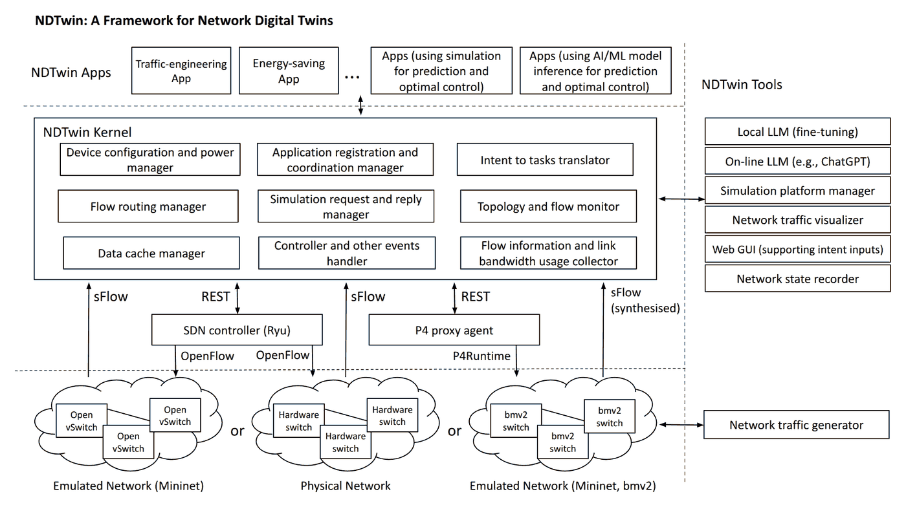
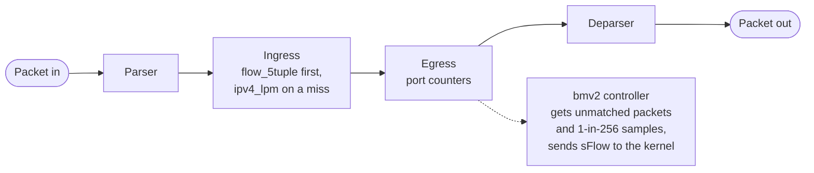

# NDTwin-Kernel-P4


> [!NOTE]
> This is work in progress. It is published so that others can try it and read the code, not as
> a release, and its interfaces may still change.

[NDTwin](https://ndtwin.org) is a network digital twin. Its kernel keeps a live picture of a
network (the topology, the flows, how busy each link is, which switches are powered on) and
offers it through one REST API. An application built on that API can watch the network, decide
on a change and apply it, without being written for one particular kind of switch.

NDTwin was built for OpenFlow switches under a Ryu controller. **This repository adds a P4 data
plane.** The same kernel and the same applications now also run on a fabric of bmv2 switches,
including one that runs a P4 program you wrote yourself.



*Figure from the NDTwin project ([ndtwin-lab](https://github.com/ndtwin-lab), <https://ndtwin.org>), used with attribution.*

This repository is the right-hand path of the figure. The box labelled *P4 proxy agent* is, in
effect, the controller of the bmv2 switches, and the rest is what it takes to make a bmv2 fabric
look to the kernel like the network it already knows.

## What is in here

- **A controller for bmv2** ([`p4_proxy/`](p4_proxy/), the *P4 proxy agent* of the figure). It
  speaks P4Runtime to the switches and offers the kernel the same northbound API that Ryu does,
  so the kernel does not need to know which data plane is underneath.
- **Traffic telemetry that matches Open vSwitch.** The P4 program samples one packet in 256 and
  the controller turns the samples into sFlow, the format the kernel already reads. Flow and link
  usage are therefore worked out the same way on both data planes.
- **Your own P4 program.** `ndt up p4 --app <dir>` brings up a fabric in which every switch
  runs your `.p4` with your table entries, and your application reads and writes those tables
  through the kernel. The steps are in
  [the P4 application guide](doc/2026-10-31_p4-app-guide.md).
- **A Python SDK** ([`sdk/python/`](sdk/python/)). One object stands for the kernel: it reads
  the topology, reads and writes P4 tables and OpenFlow entries, holds the routing lock, moves
  routes off a switch, turns switches off and on, and cuts a link for as long as a `with` block
  lasts.
- **A lab in one command.** `ndt up` starts an emulated network with the kernel on top of it
  (Open vSwitch by default, `ndt up p4` for bmv2), and `ndt down` takes it away again.

## What an application looks like

```python
import ndtwin

k = ndtwin.Kernel("http://localhost:8000")

topo = k.topology()                                 # switches, hosts and links
table = k.p4.read_table(4, "MyIngress.ipv4_lpm")    # the entries of a P4 table on switch 4

with k.lock("routing_lock", ttl=60):                # one application changes routes at a time
    k.move_routes_off(4, "MyIngress.ipv4_lpm")      # steer traffic around switch 4
    k.power_off(4)                                  # then turn it off
```

A complete example, an energy-saving application running on a P4 fabric, is in
[`examples/p4_energy_saving/`](examples/p4_energy_saving/).

## The default P4 program

When you do not bring your own, every switch runs
[`ndtwin_switch.p4`](p4_proxy/p4_src/ndtwin_switch.p4) (v1model). It is an ordinary IPv4
forwarder with two additions the twin needs. A rule for one exact flow takes priority over the
route for its destination prefix, so a single flow can be steered without disturbing the others.
And one packet in 256 is copied to the controller, which is where the kernel's view of the
traffic comes from.



Each table and header is described in [`SPEC.md`](p4_proxy/p4_src/SPEC.md).

## Getting started

Installing, building and running a lab are covered on the NDTwin website,
<https://ndtwin.org>. The REST API reference and the notes that are specific to the P4 data
plane are under [`doc/`](doc/).

## License

Apache License 2.0, see [`LICENSE`](LICENSE).
